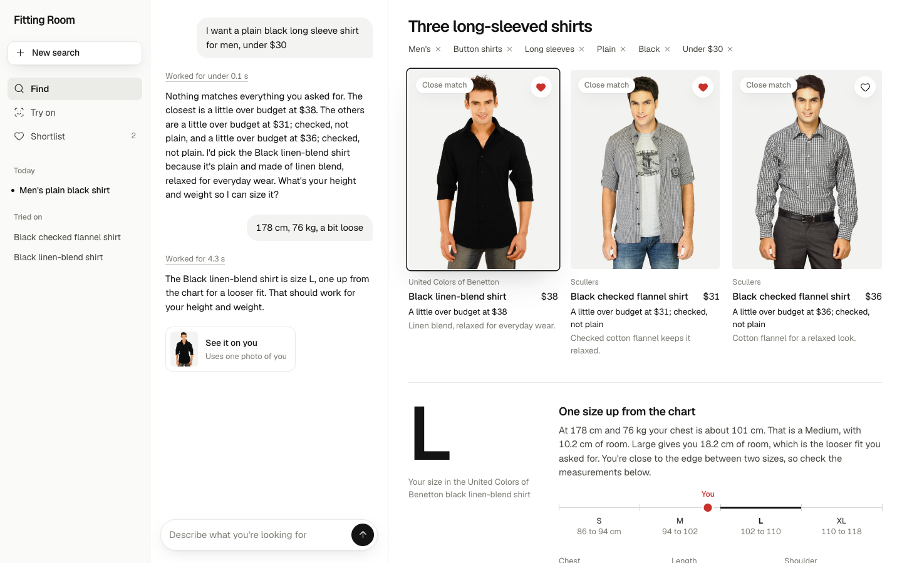
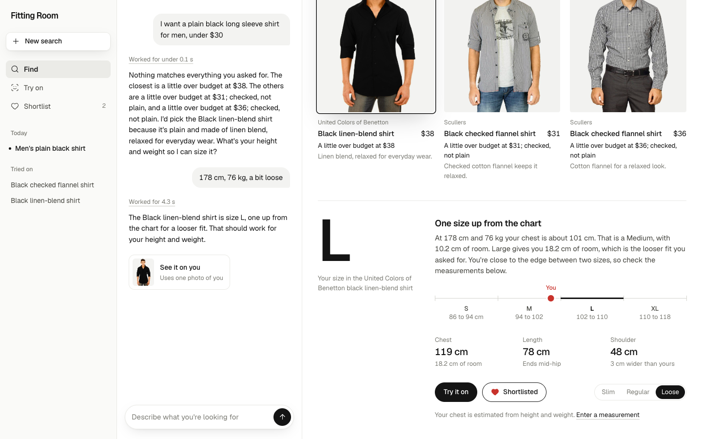
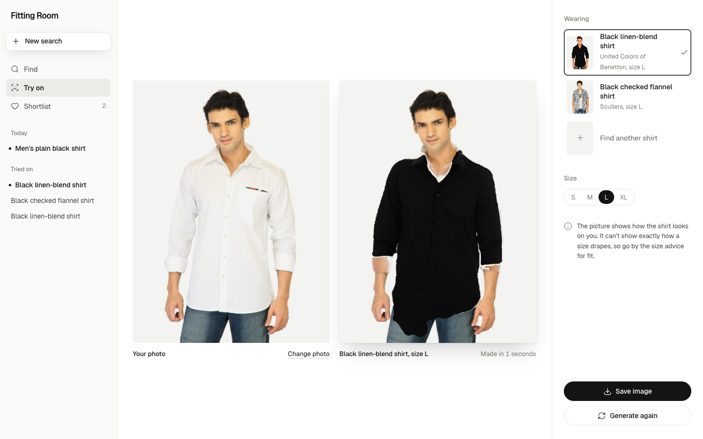
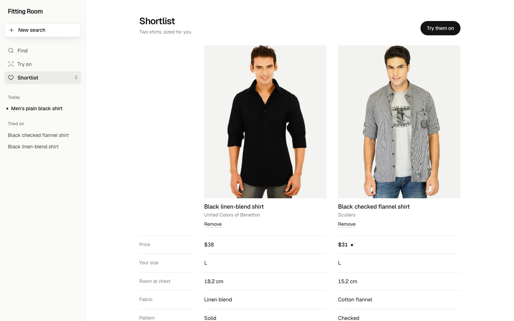
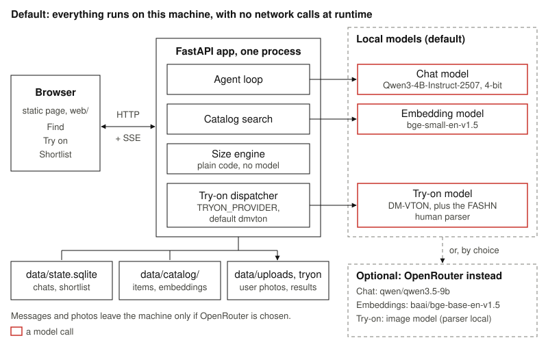

# Fitting Room

A shirt-finding chatbot that runs entirely on your own machine. You describe what you want, it asks what it needs to know, picks shirts from a 100-item catalog, recommends a size from your height and weight, and shows the shirt on your own photo.



## What it does

- **Find.** Chat search over the catalog. The agent asks up to three clarifying questions, shows its steps live (understand, search, widen, pick, size), and says plainly when a result is a near match and what it misses.
- **Size.** A size per shirt from height and weight, or from a measured chest, with a fit preference (slim, regular, loose) and each shirt's own size chart.
- **Try on.** Upload a photo and see a catalog shirt on it. Only the shirt area is changed. Face, hands, trousers and background stay the original pixels.
- **Shortlist.** Up to three shirts side by side with their recommended sizes.

| Sizing | Try on | Shortlist |
| --- | --- | --- |
|  |  |  |

## How it is built

One FastAPI process serves the page and the API and runs every model. Nothing is sent over the network at runtime.

| Job | Model | Size |
| --- | --- | --- |
| Chat | Qwen3-4B-Instruct-2507 (Q4_K_M GGUF, `llama-cpp-python`) | 2.5 GB |
| Search embeddings | bge-small-en-v1.5 | 67 MB |
| Human parser | FASHN human parser (SegFormer) | 244 MB |
| Try-on | DM-VTON | 113 MB |

The code owns the control flow. Regex rules read colour, sleeve, pattern, budget, height and weight from the message, and the model is used only for what rules cannot read. Search filters are widened by scoring violations, and gender, garment type, avoided colours and minimum price are never relaxed. The front end is plain HTML, CSS and JavaScript in `web/`, with no framework and no build step.



Full detail, measurements and the try-on model comparison are in the [build guide](docs/build-guide.md) ([PDF](docs/Fitting-Room-build-guide.pdf)).

## Run it

You need Python 3.12, [uv](https://docs.astral.sh/uv/) and `curl`. The downloads come to about 3 GB of models plus a 1.1 GB Python environment. Network access is needed for the download steps only.

```bash
uv venv -p 3.12 .venv
UV_CACHE_DIR="$PWD/.uv/cache" uv pip install -p .venv -r requirements.txt

.venv/bin/python scripts/fetch_catalog.py   # 100 catalog photos
.venv/bin/python scripts/fetch_models.py    # chat and embedding models, 2.6 GB
scripts/fetch_dmvton.sh                     # try-on model, 113 MB
scripts/fetch_tryon_model.sh                # human parser (also installs FASHN)

.venv/bin/uvicorn app.main:app --host 127.0.0.1 --port 8000
```

Then open http://127.0.0.1:8000.

The catalog data and its embeddings are committed, so `scripts/enrich_catalog.py` and `scripts/embed_catalog.py` are only needed if you rebuild the catalog or change the embedding model. On a Mac, use a Metal build of `llama-cpp-python`, otherwise chat runs on the CPU.

To look at the front end without any models, serve `web/` statically and open `index.html?mock=1`.

## Try-on backends

Set `TRYON_PROVIDER` in the environment or in `.env`. Timings are from an Apple M5 with 32 GB, the only machine tested.

| Value | Model | Time per image | Notes |
| --- | --- | --- | --- |
| `dmvton` (default) | DM-VTON | under 1 s | Fast and soft. Weak on shirts worn open and on bag straps |
| `mobilevton` | Mobile-VTON (CVPR 2026) | about 11 s | Sharper fabric, draws shirts loose and long-sleeved. Needs 7.7 to 9.8 GB of GPU memory. Fetch with `scripts/fetch_mobilevton.sh` (3.76 GB) |
| `fashn` | FASHN VTON v1.5 | about 225 s | Built for NVIDIA GPUs |
| `openrouter` | Hosted image model | 13 to 23 s | Best picture, about $0.04 per image, and your photo leaves the machine |

Chat and embeddings can also be switched to OpenRouter with `LLM_PROVIDER=openrouter`. Both hosted options read `OPENROUTER_API_KEY` from `.env`. The other settings are listed in [section 10 of the build guide](docs/build-guide.md#10-swapping-models).

## Tests

```bash
.venv/bin/pytest
```

Tests that load real models are skipped unless `RUN_SLOW=1` is set. `scripts/eval_conversations.py` runs the scripted conversations in `tests/conversations.jsonl` through the real agent. On the local model, 379 of 382 checks pass.

## Demo recording

`scripts/record_demo.py` drives the running app in headless Chrome and writes a 1080p walkthrough to `demo/` with the waiting time cut out. It needs Playwright (`uv pip install -p .venv playwright`), Google Chrome and ffmpeg, and expects the app on port 8010.

```bash
.venv/bin/python scripts/record_demo.py --photo path/to/person.jpg
```

## Layout

| Path | Contents |
| --- | --- |
| `app/` | FastAPI app, agent loop, catalog search, size engine, try-on backends |
| `web/` | Front end |
| `data/catalog/` | Catalog, hand overrides, embeddings |
| `scripts/` | Downloads, catalog build, evaluation, demo recorder |
| `tests/` | Unit, API and scripted-conversation tests |
| `design/` | The original static design mock |
| `docs/` | Build guide and diagrams |

## Limits

- This is a demo. Prices, fabrics and size charts are synthetic, and the catalog is small (100 items, 78 of them men's).
- The size estimate is a rough linear model. Measure your chest for a better answer.
- The try-on picture shows how a shirt looks on you. It says nothing about how a size fits.
- DM-VTON and Mobile-VTON are licensed CC BY-NC-SA 4.0, so this setup is for non-commercial use only.
- Catalog photos come from a public fashion dataset. Check its terms before reusing them.

The [build guide](docs/build-guide.md#14-known-limits-and-open-risks) has the full list.
