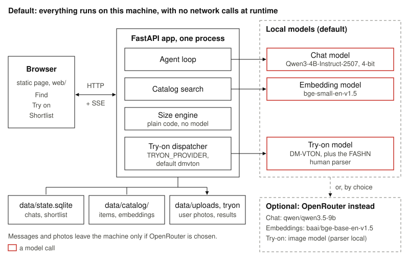
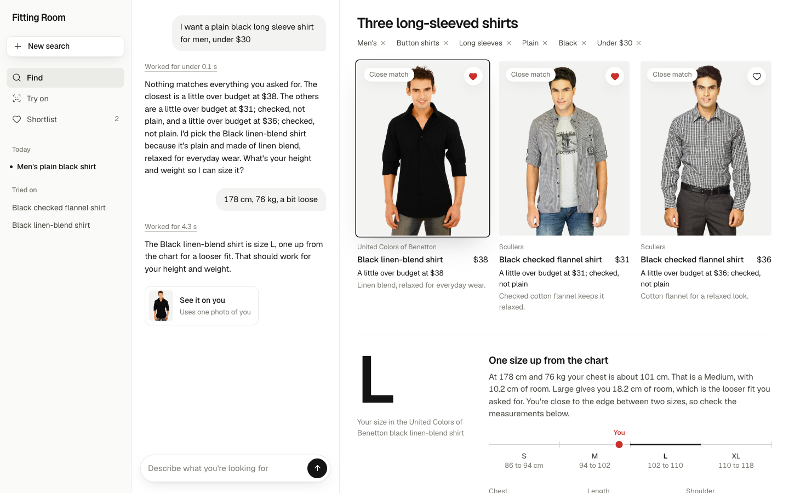
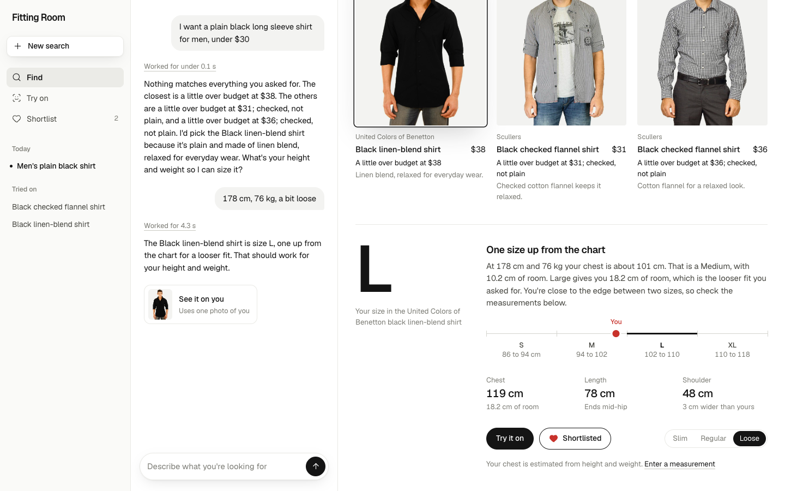
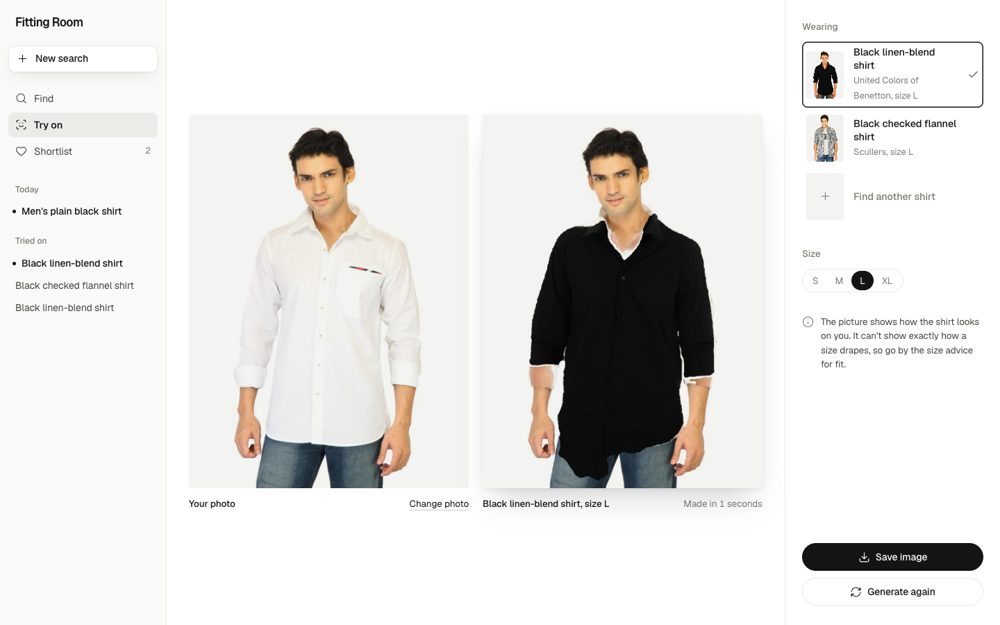
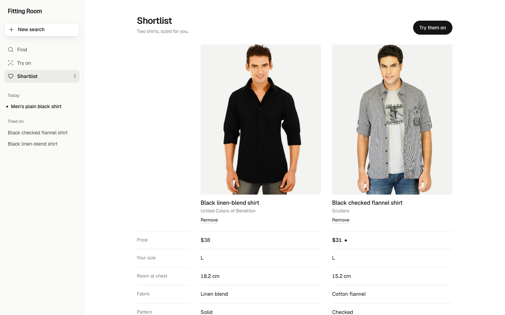
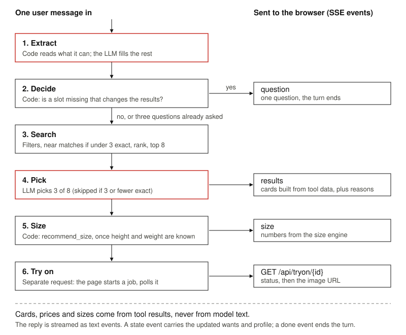
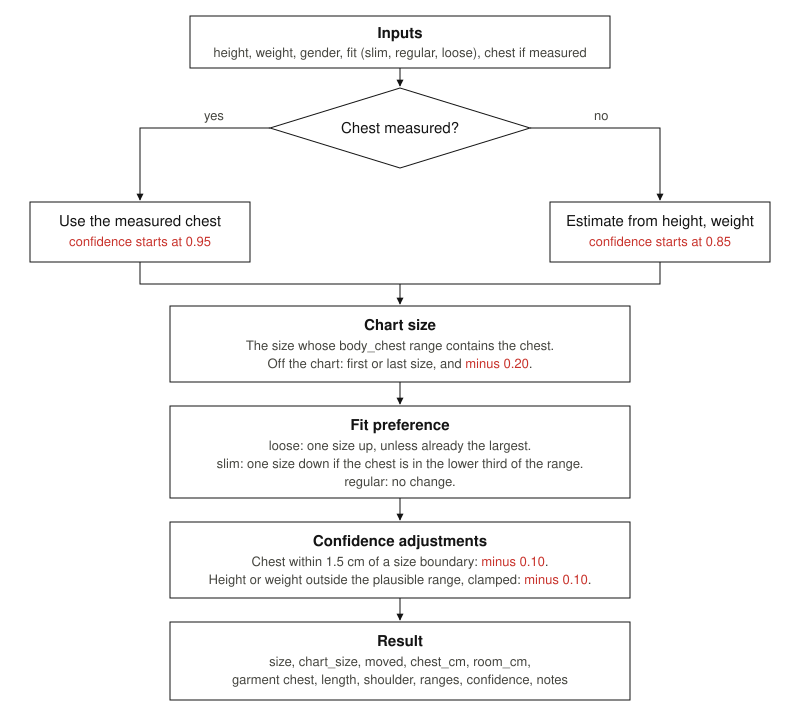
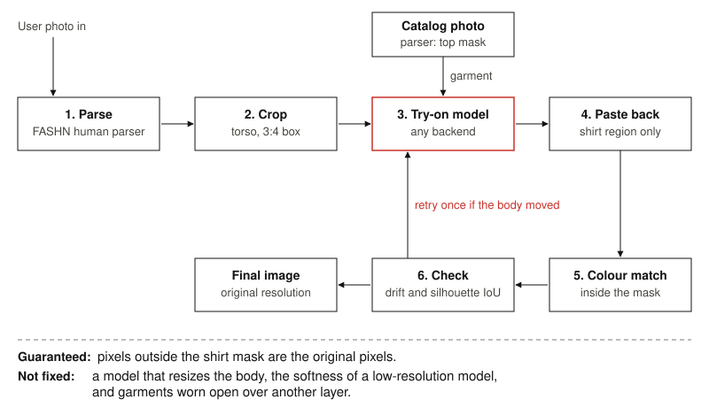
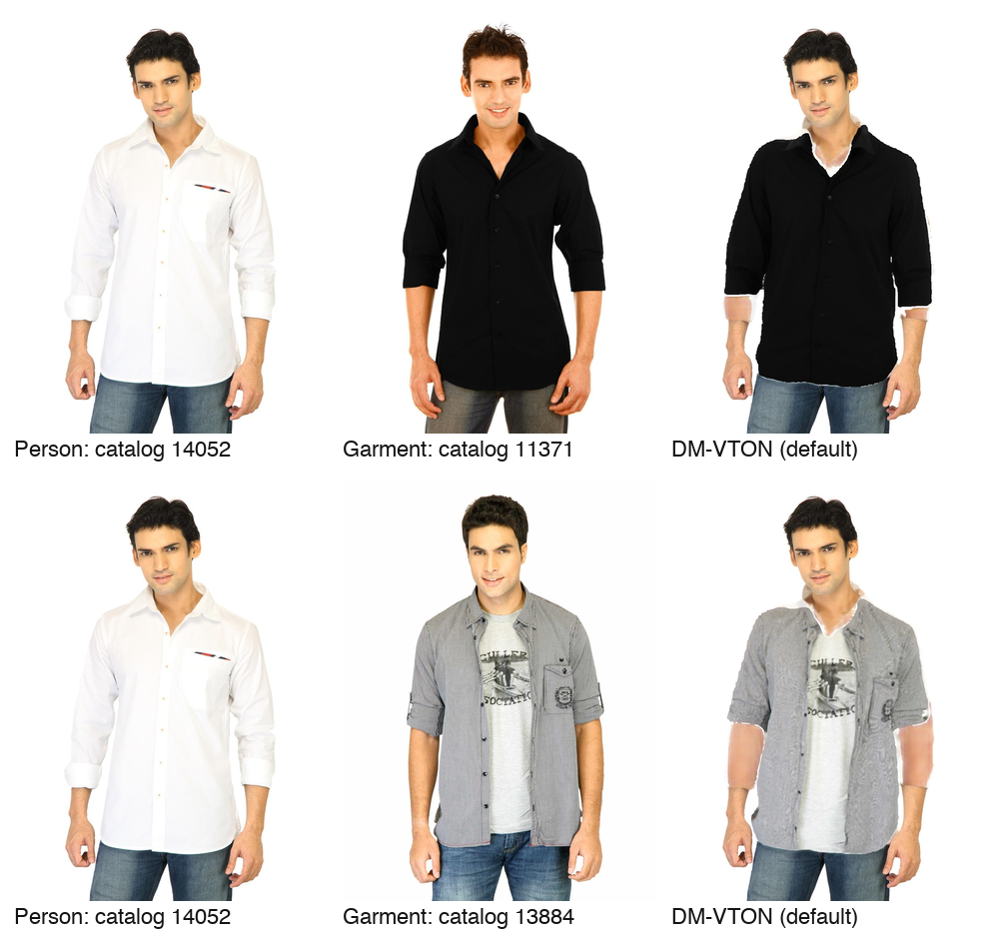
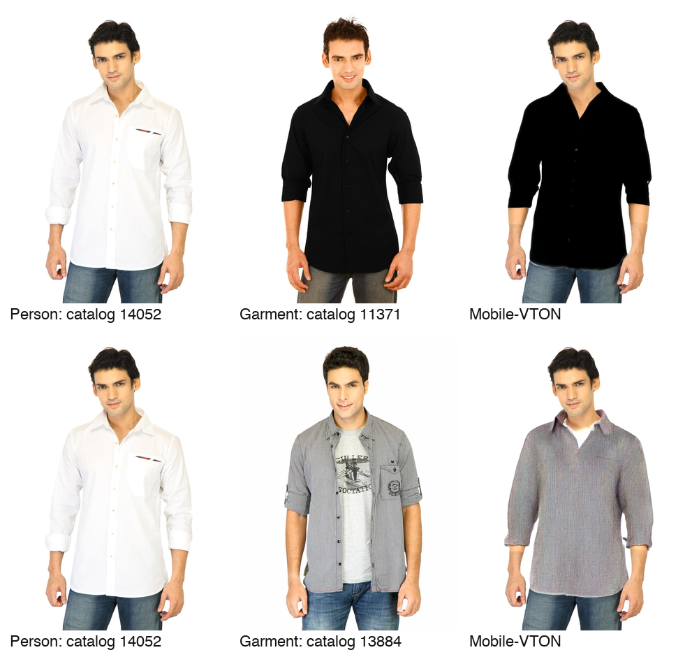

# Fitting Room: build guide

This guide explains how Fitting Room is built, for a developer who has not seen the repo. It is the current description of the project. [architecture.md](architecture.md) and [contracts.md](contracts.md) were written earlier and predate several changes. Where they disagree with this guide, this guide and the code are right. The known disagreements are: the agent has no named tools, the order in which search filters are widened is different, the chat model is run with `llama-cpp-python` and not Ollama, and the API has additions listed in section 11.

Parts of the project may still change. A sentence marked "(planned)" describes something specified but not built. Values not measured or decided are written "TBD". Both are collected at the end.

## 1. What it is and what runs where

Fitting Room is a shirt-finding chatbot. It does three jobs:

- Finds shirts from a 100-item catalog by conversation.
- Recommends a size from height and weight (or a measured chest).
- Shows the shirt on the user's own photo (virtual try-on).

It is **fully local by default**. One Python process (FastAPI) serves the web page and the API and runs three models on the same machine: a 4B chat model, a small embedding model and a try-on model (DM-VTON, with a human parser). No network call is made at runtime. Downloads happen only in `scripts/`.

OpenRouter is an **optional provider**. Chat and embeddings (`LLM_PROVIDER=openrouter`) and the try-on image model (`TRYON_PROVIDER=openrouter`) can each be switched to it independently. With either switched, message text, or the user's photo and the catalog photo, are sent to OpenRouter and on to the model provider it routes to, and their retention terms apply. Section 10 lists the swaps.



| Part | Where | Status |
| --- | --- | --- |
| Design mock | `design/index.html` | Built |
| Front end | `web/index.html`, `web/app.js`, `web/styles.css` | Built |
| HTTP app | `app/main.py` | Built |
| Agent loop | `app/agent.py` | Built |
| Provider switch, chat and embeddings | `app/models.py` | Built |
| Local chat and embeddings | `app/llm.py` | Built |
| Hosted chat and embeddings | `app/llm_openrouter.py` | Built, optional |
| Catalog load and search | `app/catalog.py` | Built |
| Size engine | `app/sizing.py` | Built |
| State, uploads, usage counters | `app/store.py` | Built |
| Try-on dispatcher | `app/tryon.py` | Built |
| Try-on backends | `app/tryon_dmvton.py` (default), `tryon_mobilevton.py`, `tryon_openrouter.py`, `tryon_fashn.py` | Built |
| Shared mask, crop, composite | `app/tryon_composite.py` | Built |
| Oxygen-TryOn backend | none | Not built |

Settled defaults: `LLM_PROVIDER` is `local`, `TRYON_PROVIDER` is `dmvton`.

### Test machine

Every measurement in this guide was taken on one machine, and nothing else was tested:

| Item | Value |
| --- | --- |
| Chip | Apple M5, 10 CPU cores |
| Memory | 32 GB (34,359,738,368 bytes) |
| OS | macOS 26.6.2 |
| Libraries | Python 3.12, torch 2.15 with MPS (Apple GPU), llama-cpp-python 0.3.38 (Metal) |
| GPU | Apple GPU only. No NVIDIA GPU |

Several timings were taken while another job was using the machine. Where that applies they are upper bounds, and the text says so. Any "minimum" stated for other hardware is an estimate and is labelled with its basis: a model file size, the author's stated requirement, or a memory figure we measured. Nothing was tested with less than 32 GB of memory.

## 2. The UI: Find, Try on, Shortlist

The UI has three views, switched from the left sidebar. The sidebar also holds a "New search" button and the conversation history. The screenshots below are of the running local app, captured at 1440 by 900. The try-on view uses a catalog photo (14052) as the uploaded "person", not a personal photo.

### Find

Chat on the left, results on the right. The results column shows a heading, the active filters as removable chips, three shirt cards (photo, brand, name, price, a badge, a line saying how it differs from the request, a one-line reason, a heart to shortlist), and below them the sizing block. Each assistant message has a "Worked for" line that opens the pipeline steps with their timings.



The sizing block is the lower part of the right column. It shows the recommended size as a large letter, a sentence on why, a scale of the size ranges with the user's chest marked, chest, length and shoulder of the garment, a slim, regular, loose switch, and a link to enter a measured chest.



### Try on

The user's photo on the left, the generated image on the right. The side panel lists the shirts being worn, a size switch, a note that the picture shows the look and not how a size drapes, and buttons to save the image or generate again. This screenshot shows an image the running server produced earlier from the same catalog photo, so it can differ slightly from the figure in section 7.



### Shortlist

A side-by-side comparison of the shirts the user has hearted: price, size, room at chest, fabric, pattern and more. The shortlist holds at most 3 shirts.



### One conversation, start to finish

This is the conversation in the screenshots. Each step names what the backend does.

1. The user writes: "I want a plain black long sleeve shirt for men, under $30". Code reads the type, sleeve, colour, pattern, gender and budget. Nothing is missing, so it searches. Nothing in the catalog meets every criterion, so near matches fill the list (section 5). The cards say "A little over budget at $38", and the checked ones also say "checked, not plain".
2. The reply is composed from facts: nothing matches everything, the closest is a little over budget, and which one it would pick. It then asks for height and weight.
3. The user writes: "178 cm, 76 kg, a bit loose". Code reads height, weight and fit. No new search is needed. The size engine runs: chest about 101 cm, M on the chart, L for a loose fit. A `size` event fills the sizing block.
4. The user presses "See it on you", uploads one photo, and the try-on view shows the result when the job finishes.

## 3. Architecture and the request flow of one chat turn

Components:

- **Static front end** (`web/`). Plain HTML, CSS and JavaScript served by the app at `/`. The Geist font and Lucide icons are bundled, so the page loads nothing from third-party hosts.
- **FastAPI app** (`app/main.py`). Serves the front end and the API on `127.0.0.1:8000`. Chat replies stream over Server-Sent Events (SSE). Each visitor gets an opaque random cookie, and conversations, shortlist, photos and try-ons are scoped to it. In local mode the models load in the background at startup.
- **Agent loop** (`app/agent.py`). Code owns the control flow. The model is called for reading what code cannot read, and for choosing and describing shirts.
- **Provider switch** (`app/models.py`). The rest of the app calls `chat`, `chat_stream`, `embed` and `unload` here. `LLM_PROVIDER` is `local` (default, even with an OpenRouter key present) or `openrouter`.
- **Catalog search** (`app/catalog.py`). Filters, then ranking by cosine similarity over precomputed embeddings, otherwise IDF-weighted keyword overlap. With 100 items there is no vector database.
- **Size engine** (`app/sizing.py`). Plain Python, no model.
- **Try-on** (`app/tryon.py` and the backends, section 7).
- **State** (`data/state.sqlite`, gitignored). Conversations, shortlist, photos, try-on jobs and usage counters.

### Request flow of one chat turn



1. **Extract.** Code reads as much as it can directly: sleeve, colours, pattern, type, usage, budget phrasings, gender words, and heights and weights in cm, kg, feet, pounds or stone, including a bare pair like "178, 76". The model fills only the occasion, the conversation title, references to earlier results, and unusual numbers. When code can read the whole message there is no model call. The test message "I want a plain black shirt for men, either sleeve, under $40" went from 10.5 s to 1.34 s end to end after this change. A turn that still calls the model spends about 3.5 s reading the request and about 0.5 s on the reply.
2. **Decide.** Code checks whether a slot that changes the result set is missing. If so it sends one `question` event and the turn ends. Up to three clarifying questions are asked per search.
3. **Search.** `catalog.search` returns the top 8. If fewer than 3 shirts meet every criterion, near matches fill the list (section 5).
4. **Pick.** The model chooses 3 of the 8 and writes one reason each. The call is skipped when three or fewer shirts match exactly.
5. **Size.** If height and weight (or a chest) are known, `recommend_size` runs for the best match.
6. **Try on.** Not part of the chat turn. The page starts a job with `POST /api/tryon` and polls `GET /api/tryon/{job_id}`.

### Step events

The agent streams `step` events so the UI can show real progress, each with a label, a plain-words detail with real counts, and the measured time in milliseconds. The ids are `understand`, `decide`, `search`, `widen`, `pick`, `size` and `write`. Each is sent first with status `start`, then with status `done`, and the finished steps are stored with the message (`messages[].steps`).

### Safeguards in the HTTP app

- Uploads are limited to 8 MB, must decode as images, and are re-encoded on receipt, which drops metadata such as EXIF location. Images over 40 million pixels are refused and the longest side is capped at 2048 pixels.
- Uploaded photos and try-on results are deleted after 24 hours, swept hourly.
- Daily caps per IP address and globally return HTTP 429. They apply only to a hosted provider: to chat when chat is on OpenRouter, to try-on when try-on is on OpenRouter. There are no rate limits in local mode. Defaults are 60 messages per IP and 600 global, and 5 try-ons per IP and 60 global (`RATE_CHAT_PER_IP`, `RATE_CHAT_GLOBAL`, `RATE_TRYON_PER_IP`, `RATE_TRYON_GLOBAL`).
- `GET /api/status` reports `mode`, the providers and a `privacy` sentence.
- The OpenRouter key lives in `.env` (gitignored) and is never sent to the browser.
- A test (`tests/test_local_mode.py`) runs a full local session through the API and fails if any network connection is attempted.

## 4. The catalog

### Where the 100 shirts come from

`scripts/fetch_catalog.py` downloads them from the Hugging Face dataset `benitomartin/fashion-product-images-small-900x1200`, a re-hosted, upscaled copy of the Kaggle "Fashion Product Images" set. The script:

- Queries the datasets-server filter API for `articleType` equal to `Shirts` (60 wanted) and `Tshirts` (40 wanted), 100 rows per request.
- Takes rows deterministically: the first 60 `Shirts` rows, and every second `Tshirts` row until it has 40. A rerun gives the same 100.
- Saves each photo to `data/catalog/images/<id>.jpg` (900 by 1200 pixels) and the metadata to `data/catalog/raw.json`.

`data/catalog/images/` is gitignored. The photos are fetched by the script.

### What the dataset gives

Each record has: `id`, `gender`, `masterCategory`, `subCategory`, `articleType`, `baseColour`, `season`, `year`, `usage`, `productDisplayName` and the image path. In the 100 records:

| Field | Values |
| --- | --- |
| Article type | 60 Shirts, 40 Tshirts |
| Gender | 82 Men, 15 Women, 3 Boys |
| Usage | 85 Casual, 8 Formal, 5 Sports, 2 Ethnic |
| Season | 52 Fall, 47 Summer, 1 Spring |
| Year | 2010 to 2013 |
| Base colour | 16 values; most common Blue (19), Black (15), Red (12), White (10) |

The set has no girls or unisex items, no winter items, and no brand column.

### What is added at ingest

`scripts/enrich_catalog.py` turns `raw.json` into `data/catalog/catalog.json`, in the item shape in [contracts.md](contracts.md). Run it with `HF_HOME=$PWD/models/hf .venv/bin/python scripts/enrich_catalog.py`.

Parsed from the dataset:

- **Brand**, from the start of the product name by longest match against a table of 43 known brands, falling back to the first word.
- **Gender**, from the dataset field and the name. A kids word in the name makes an item `boys` or `girls`. Four items move from `men` to `boys`: 78 men, 15 women, 7 boys.
- **Type**, **colour**, **usage** and **season**, lower-cased.

Read from the photo, then corrected by hand:

- **Sleeve length and pattern** are first predicted by zero-shot CLIP (`openai/clip-vit-base-patch32`, in `models/clip-b32/`). A pattern cue in the product name wins over CLIP. Predictions are cached in `data/catalog/clip_predictions.json`.
- CLIP did poorly on sleeves, so every photo was checked by eye. 48 items carry hand corrections in `data/catalog/overrides.json` (38 sleeve fixes, 19 pattern fixes), applied last.
- Result: 56 short sleeve and 44 long sleeve; 28 checked, 28 solid, 23 printed, 21 striped.
- Collar is not extracted. [architecture.md](architecture.md) lists it, the contract does not.

Built from the other fields:

- **Display name**, from colour, pattern, fabric and type, for example "Navy blue checked flannel shirt". The dataset name is kept in `source_name`.
- **Description sentence**, for example "Navy blue short-sleeved casual shirt in cotton flannel by Turtle, checked, relaxed fit, for men, fall." This is what gets embedded.
- **Garment notes** (`data/catalog/garment_notes.json`), used by the hosted try-on prompt.
- **Worn-open list** (`data/catalog/worn_open.json`), a reviewed list of items whose catalog photo shows the shirt worn open over another top. 1 of the 100 items (13884) is. `scripts/detect_worn_open.py` proposes candidates for review.

`scripts/embed_catalog.py` embeds every description through the active provider and writes `embeddings.npy`, `embeddings_ids.json` and `embeddings_meta.json`. The meta file records which model made the vectors (now `local:bge-small-en-v1.5-f16`, 384 dimensions, 100 items). Search uses the vectors only when that name matches the active embedding model and otherwise falls back to keyword ranking, because vectors from different models must not be compared.

### What is synthetic

These fields are invented and are listed in each item's `synthetic` array. They are seeded by item id, so a rerun gives the same values.

- **Price**: a whole-dollar number from a range by type and usage (for example 28 to 58 for casual shirts, 52 to 75 for formal shirts, 14 to 28 for T-shirts), with a few dollars added for a premium brand and 25% off for children's items. Prices run from $14 to $75.
- **Fabric**: chosen by rule from type, usage, pattern and name cues. It is not read from the photo.
- **Garment fit**: `slim`, `regular` or `relaxed`, from the name or a seeded draw.
- **Size chart**: sizes S, M, L and XL, each with a `body_chest` range, garment chest, length and shoulder. Each gender has a template of contiguous 8 cm chest ranges (6 cm for children). Garment chest is the middle of the range plus an ease set by the fit. A per-brand offset of -1, 0 or +1 cm makes brands differ slightly. Men's ranges are S 86 to 94, M 94 to 102, L 102 to 110, XL 110 to 118.

The photos and the dataset's own fields are real. Everything above is made up, so a size recommendation demonstrates the logic and is not a real brand's fit. The catalog is narrow: 78 of 100 items are men's and 85 are casual.

## 5. The agent

### State

Kept per conversation in `data/state.sqlite`:

| Key | Contents |
| --- | --- |
| `wants` | occasion, type, sleeve, pattern, colours wanted and avoided, budget, usage, gender |
| `profile` | height, weight, chest (measured or estimated), fit, gender |
| `results`, `size`, `selected` | latest result set, size recommendation, shirt in focus |
| `questions`, `asked`, `pending` | how many questions were asked, and which |

The `state` event sends `wants` and `profile` after each turn, which keeps the filter chips in sync. A chip is removed with `remove_filter` on `POST /api/chat`, which clears that criterion without a model call.

### The per-turn loop

The loop is the steps in section 3. The model never decides when to search or ask. Code decides, from which slots are filled.

- "Who is it for?" is asked first when the gender is unknown. Gender is a hard filter, never relaxed.
- Then sleeve, budget and colours to avoid are asked as needed. At most three questions are asked per search.
- The sentence saying how many shirts matched is composed by code, not by the model.

### How search widens

Filters are `gender`, `type`, `sleeve`, `pattern`, `usage`, `colours` (any of), `avoid_colours`, `max_price` and `min_price`. Colour matching is by family, so "blue" also matches navy and teal, and avoiding white also removes off-white and cream.

- **Never relaxed:** gender, type, colours to avoid, minimum price.
- **Every other criterion counts as a violation when broken**, with a severity:

| Criterion | Small violation | Medium violation | Excluded |
| --- | --- | --- | --- |
| Price over budget | up to 35% over | up to 60% over | more than 60% over |
| Colour | a near shade (grey for black; navy is not near black) | any other colour | none |
| Pattern, sleeve | none | always medium | none |
| Usage | always small | none | none |

When fewer than three items match everything, near matches fill the list. They are ranked by the number of violations, then total severity, then relevance, so an item breaking one criterion always beats one breaking two.

Each result carries `exact`, `near` (every violation, in words, from real fields), `violations` and `worn_open`. The `results` event carries `exact_count`. Exact matches always come before near ones. Results are sorted by score, then price, then id within a rank.

Worked example: "plain black long-sleeved men's shirt under $30". No item meets every criterion. The first result is the plain black shirt at $38, with the line "A little over budget at $38". The next two are black checked shirts at $31 and $36, each with "A little over budget" and "checked, not plain".

### What the code calls

[architecture.md](architecture.md) describes four tools. The agent does not expose them as named functions. It calls `catalog.search`, and `size_for` in `app/agent.py`, which calls `sizing.recommend_size`. Try-on is started by the page through `POST /api/tryon`, not by the agent.

### Guard rails

- The UI renders cards and size numbers from tool results, never from model text.
- A model pick whose id is not among the candidates is dropped and backfilled.
- Each reason line is checked in code: short, not a restatement of the name, colour or sleeve, and different from the other reasons. A reason that fails is replaced by one built from the item's fabric, usage and the occasion.
- A size is never shown without a recommendation: the `size` event exists only when the size engine returned one.
- The shortlist is capped at 3 (HTTP 409 beyond that).
- Extraction output is constrained by a JSON Schema. The local path uses a grammar, so the output always parses. A schema does not stop a wrong value, which is why code reads what it can.

## 6. The size engine

`app/sizing.py` is plain Python with no model and no network. It exposes `estimate_body(height_cm, weight_kg, gender)` and `recommend_size(item, profile)`.



### How chest is estimated

A linear model per adult reference group: `value = mean + slope_weight * (weight - mean_weight) + slope_height * (height - mean_height)`.

| Group | Mean height / weight | Chest: mean, cm/kg, cm/cm | Shoulder: mean, cm/kg, cm/cm |
| --- | --- | --- | --- |
| men | 175.6 cm / 85.5 kg | 105.9, 0.55, 0.05 | 46.0, 0.10, 0.10 |
| women | 162.8 cm / 67.8 kg | 94.7, 0.60, 0.05 | 40.0, 0.09, 0.09 |

The means come from ANSUR II summary statistics. The slopes are hand-set approximations that reflect chest tracking weight strongly and height weakly. This is not a regression fit: the raw ANSUR II data is not in the repo. The tests check the model against anchor cases (178 cm and 76 kg gives 98 to 102 cm).

- `boys` and `girls` use the adult model of the matching group at the same BMI on the reference height, scaled by height ratio (capped at 1). `unisex` averages men and women.
- Height must be 100 to 230 cm and weight 25 to 250 kg, otherwise `ValueError`.
- If BMI is outside 14 to 50, the weight is clamped and the result is marked. Chest is clamped to 60 to 150 cm.
- A measured `chest_cm` replaces the estimate.

Worked example: a man at 178 cm and 76 kg gives 105.9 + 0.55 * (76 - 85.5) + 0.05 * (178 - 175.6) = 100.8 cm.

### How the size is picked

1. **Chart size.** Find the size whose `body_chest` range contains the chest. Ranges are half open, so 94 falls in M (94 to 102) and 93.9 in S. A chest off the chart gets the first or last size and a `below_chart` or `above_chart` note.
2. **Fit preference.** `loose` moves one size up unless already the largest. `slim` moves one size down if the chest is in the lower third of its range and the size is not the smallest. `regular` does not move.
3. **Output.** The size, the `chart_size` before the fit move, `moved`, chest, `room_cm` (garment chest minus body chest), the garment's chest, length and shoulder, the shoulder difference, all ranges, confidence and notes.

A `length_note` of `short`, `mid_hip` or `long` comes from garment length divided by height: below 0.41 is short, 0.45 and above is long.

In the screenshots the chest of 100.8 cm is in M on the chart, loose moves it to L, and the black shirt's L has 18.2 cm of room (its garment chest is 119 cm).

### Confidence

A number from 0 to 1 that starts at 0.95 for a measured chest and 0.85 for an estimated one. Then: chest within 1.5 cm of a size boundary, minus 0.10 (`near_size_boundary`); chest off the chart, minus 0.20; height or weight clamped, minus 0.10 (`inputs_clamped`). For 178 cm and 76 kg, 100.8 cm is 1.2 cm from the 102 boundary, so the confidence is 0.75. The language model never computes any of these numbers. It only phrases the result.

## 7. Try-on

Try-on takes the user's photo and a catalog photo and returns an image of the user wearing the shirt. The image shows the look of the shirt on this person. It does not show how a size fits: the size choice does not change the picture, and the UI says so. Size advice comes from the size engine.

`app/tryon.py` dispatches on `TRYON_PROVIDER`:

| `TRYON_PROVIDER` | Backend | Status |
| --- | --- | --- |
| `dmvton` (default) | DM-VTON, local | Built |
| `mobilevton` | Mobile-VTON, local | Built, optional |
| `openrouter` | Hosted image model inside the pipeline | Built, optional |
| `fashn` | FASHN VTON v1.5, local | Built, optional |
| `oxygen` | Oxygen-TryOn | Not built; raises "not built yet" |

`quality` is `fast`, `balanced` or `best` for the DM-VTON and hosted backends. Mobile-VTON uses `fast`, `balanced` or `high` (below).

### The pipeline around the model

The key engineering result is that the model is not trusted with the whole picture. Every backend runs inside the same steps (`app/tryon_composite.py` plus each backend):



1. **Parse** the user's photo and the catalog photo with the local FASHN human parser (a SegFormer, about 244 MB). The first load takes about 5 s. Parsing one image takes about 1.3 s on CPU and 0.11 to 0.12 s on the Apple GPU.
2. **Extract the garment** from the catalog photo with the parser's top mask.
3. **Crop** the user's photo to the torso (a 3:4 box around the top and arms).
4. **Run the try-on model** on the crop and the garment. This is the only step that differs between backends.
5. **Paste back only the shirt region** into the full-resolution original. The edit mask is the shirt area minus protected classes taken from the original: face, hair, hands, glasses, hat, jewellery, bag, belt, trousers, skirt, legs and feet. The mask edge is feathered.
6. **Colour match** the pasted shirt to the catalog garment inside the mask.
7. **Check** drift and silhouette overlap (IoU) between the original and generated person. If the body moved, the edit is retried once and the better result kept. If the silhouette is misaligned, only the original shirt mask is used, so the outline cannot grow.

It guarantees that every pixel outside the shirt mask is the original pixel, at the original resolution. It cannot fix a model that resizes the body, the softness of a low-resolution model, or a garment worn open over another layer.

### Five approaches compared

The same personal photo and the same two garments were run through each approach. The photo is 1536 by 2048 pixels, a mirror selfie with one arm raised holding a phone and backpack straps over the shirt. The garments are a plain black shirt, and a fine black-and-white checked shirt that its catalog photo shows worn open over a white printed T-shirt. Comparison images on that personal photo were reviewed during development and are not reproduced here.

| Approach | Runs on | Time per image | Cost | Verdict |
| --- | --- | --- | --- | --- |
| 1. General image editor alone | OpenRouter | about 6 s | $0.0342 | Redrew the picture. Not usable |
| 2. Hosted pipeline | OpenRouter, parser local | 13 to 23 s | $0.0375 to $0.040 | Best result |
| 3. FASHN VTON v1.5 | Local, Apple GPU | 225.45 s and 227.43 s | free | Faithful scene, wrong shirt colour |
| 4. DM-VTON, with fixes | Local, Apple GPU | 0.5 to 0.85 s warm | free | Recognisable, soft, fastest |
| 5. Mobile-VTON | Local, Apple GPU | about 10.5 to 11.3 s warm (upper bound) | free | Mixed against DM-VTON |

**1. General image editor alone.** `google/gemini-3.1-flash-lite-image` through OpenRouter, given the person photo, the garment photo and a prompt: about 6 s, $0.0342 per image (billed). It redrew the whole picture: the body came out broader, the trousers changed, the backpack straps were removed and the catalog model's T-shirt was copied.

**2. Hosted pipeline.** `google/gemini-nano-banana-2.1` inside the pipeline: $0.0375 to $0.040 and 13 to 23 s per image. One measured run took 19.9 s, cost $0.0375, drift 0.0012, IoU 0.982, no retry. Everything outside the shirt is the original pixels (trousers, face, hand, phone, watch, straps, background) at full 1536 by 2048 resolution. The shirt is accurate: black is black, and the check, pocket and crest appear. Small caveats: the checked shirt reads slightly lighter and cooler than the catalog, and a thin light fringe runs along the top of the phone hand. Other models tried in this pipeline: `google/gemini-3.1-flash-image` ($0.069) and `google/gemini-3-pro-image` ($0.143), only marginally better on the shirt; `openai/gpt-5.4-image-2` ($0.198, 85 s), which rescaled the frame; and the flash-lite model again, which redrew body and trousers.

**3. FASHN VTON v1.5.** 972 million parameters, about 2.2 GB of weights plus a 244 MB parser, Apache-2.0. Load took 12.8 s. Two images took 225.45 s and 227.43 s at 20 steps on the Apple GPU, about 10.8 s per step, while another job was using the machine (upper bounds). Output is 576 by 768. Background, face and pose were kept. The black shirt came out dark navy, the backpack straps were removed, the arm came out slightly thicker and the trouser texture was regenerated. For the checked shirt it copied the under-layer T-shirt and rendered the shirt pale grey. Its README targets CUDA, and on the Apple GPU it runs in float32.

**4. DM-VTON.** A 2023 distilled flow-warping student network. Weights are `dmvton_pf_warp.pt` (86 MB) and `dmvton_pf_gen.pt` (26 MB), trained on VITON at 192 by 256. The licence is CC BY-NC-SA 4.0, "for academic purposes only": no commercial use without the authors' permission. The reference code needs CUDA and cupy for one layer. `app/tryon_dmvton.py` replaces it with a pure-PyTorch correlation (7 by 7 window, channel-averaged, zero padding) that matches a reference to 1.7e-7 on CPU and 1.8e-7 on the Apple GPU, and the vendored code is untouched. Painting the background white before the model is essential: without it the result collapses (IoU 0.85).

After the quality fixes below it takes about 0.5 to 0.85 s warm through the API. The stages the UI shows are "Reading your photo", "Preparing the shirt", "Fitting the shirt to your photo" and "Blending it into your photo". Timings on the 1536 by 2048 photo before those fixes, in seconds:

| Case | Load | Parser | DM-VTON | Composite | Total |
| --- | --- | --- | --- | --- | --- |
| Cold, parser on CPU | 0.63 | 2.12 | 0.35 | 0.99 | 5.36 |
| Cold, parser on Apple GPU | 0.62 | 1.70 | 0.19 | 0.22 | 3.11 |
| Warm, model on GPU, parser on CPU | n/a | 0.94 to 1.0 | 0.07 to 0.10 | 1.03 to 1.56 | 2.2 to 2.8 |
| Warm, model and parser on GPU | n/a | 0.11 to 0.12 | 0.06 to 0.07 | 0.21 | 0.54 to 0.56 |
| Warm, all on CPU | n/a | 0.95 to 1.03 | 0.22 to 0.24 | 1.0 to 1.1 | 2.36 to 2.48 |

Garment preparation takes about 1.1 s once per garment and is then cached. The upscale step, about 0.01 s, is omitted from the table.

What we changed, and what worked:

- The catalog garment is warped at 4 times its resolution with DM-VTON's own flow field, so the fabric is sharp and the colours are the catalog's. This was the biggest improvement.
- The paste mask is built at full resolution. The old shirt showing outside the new one is inpainted, and edge pixels take colours from inside the garment. The white outline is mostly gone, and a faint pale edge remains in places.
- A median filter removes collar specks, and photo-matched grain is added inside the shirt.

What did not work, and is switched off by default:

- Strap protection. The colour-and-shape rule also caught shirt piping and shadows, and cannot work on dark shirts (`DMVTON_STRAPS=0`).
- Arm detail. Skin colour matching plus texture made the arms worse (`DMVTON_ARM=0`).
- A true untucked hem. The rule exists and the trousers stay pixel-identical with it off, but DM-VTON's warped garment ends at the original waistline, so the visible change is small.
- Closing an open-worn shirt. It duplicated the placket (`DMVTON_CLOSE_FRONT=0`). Instead, `worn_open.json` lists the items that are really worn open (1 of 100), and the try-on job returns a plain `note` for those items.

Remaining quality limits: garments are recognisable at normal size and the black shirt colour is correct, but the result is softer than the catalog photo, the catalog under-layer T-shirt is copied, the backpack straps were erased (the parser labels them as top), and the pose is outside the model's training distribution (front-facing, arms down). Roughly FASHN's level at thumbnail size, about 400 times faster, and clearly below the hosted pipeline.

**5. Mobile-VTON.** "High-Fidelity On-Device Virtual Try-On", CVPR 2026 (arXiv 2603.00947, code at github.com/tmllab/2026_CVPR_Mobile-VTON, weights at huggingface.co/FlashStight/Mobile-VTON). A distilled diffusion model (TeacherNet, GarmentNet and TryonNet) designed for on-device use at 1024 by 768. Code and checkpoint are CC BY-NC-SA 4.0, so non-commercial. It is built into the repo as `app/tryon_mobilevton.py`, selected with `TRYON_PROVIDER=mobilevton`, fetched by `scripts/fetch_mobilevton.sh`, and tested by `tests/test_tryon_mobilevton.py` (4 pass with `RUN_SLOW=1`). It is not the default.

- **Inputs.** It is mask-free: it needs no DensePose and no agnostic mask (the vendor inference code never reads them; they appear only in the README's folder layout). It takes the person image, the garment image at the same size, a text caption, and the garment again for its image encoder. We feed it the parser's shirt cut-out on white at 768 by 1024, a caption built from catalog fields in the vendor's form ("Replace the upper body with ..."), and a 3:4 crop around top and arms, then run the usual composite.
- **Port.** Only `diffusers` 0.43 was added, with torch unchanged and the vendor code unedited. Two workarounds live in our module: re-exporting `MultiControlNetModel` under its old name, and rebuilding the position tables with the vendor's own resize function so it runs at sizes other than 1024 by 768. It runs on the Apple GPU in fp16 with no CPU fallback.
- **Size and memory.** The checkpoint is 3,755,734,576 bytes (3.5 GiB), and every file was verified against the Hugging Face listing by size and SHA-256. Peak GPU memory was 7.7 to 9.8 GB (measured).
- **Quality levels.** `fast` is 8 steps at 768, `balanced` is 8 steps at 1024, `high` is 28 steps at 1024 (the vendor default).
- **Timings,** model call only, warm. A full run adds about 0.5 s. The machine was busy, so these are upper bounds:

| Setting | Time | Note |
| --- | --- | --- |
| Model load | 6.1 to 7.3 s | |
| 28 steps at 1024 | 32 to 50 s | No better than 8 steps |
| 12 steps at 1024 | 15 to 16 s | |
| 8 steps at 1024 | 10.0 to 10.8 s | Best usable |
| 4 steps at 1024 | 5.5 to 6 s | Wrong blue sleeve on the checked shirt |
| 8 steps at 768 | 5.6 to 7 s | Fine for plain black; stains and a broken placket on the check |
| 8 to 12 steps at 512 | 2.6 to 3.7 s | Unusable |
| Guidance 1.0, 8 steps | about 6 s | Fails: the black shirt comes out grey |

The reviewer's own reading of the comparison, not a measurement: Mobile-VTON is mixed against DM-VTON and not a clear win. Better: it paints the shirt onto the body, so a shirt photographed open over a T-shirt is drawn closed with a real fine check and no copied under-layer, and there is no blurry invented bare arm. Worse: it rendered both test shirts long-sleeved and loose, which makes the torso and arm look bulkier. The plain black shirt is softer than DM-VTON's result after the high-resolution warp fix. The checked shirt came out lighter and bluer than the catalog, with a faint green tint on the raised sleeve, two odd buttons and no pocket badge. As with DM-VTON, the backpack straps were erased and dark specks appear on the chest. It is about 20 times slower than DM-VTON. The hosted pipeline remains best on both garments. This was tested on one person photo and one seed only.

### Examples from catalog photos

These figures use a catalog model photo (14052) as the "person" and catalog garments 11371 and 13884, so no personal photo is involved. Both ran locally on the test machine. They are single examples, not a benchmark.



DM-VTON: the black shirt is the right colour and is recognisable, with the fabric clearly sharper than before the fixes. There are thin pale outlines at the collar, cuffs and hem, and pale pinkish patches on the forearms where the original long sleeves ended. The checked shirt shows its fine check. The grey printed T-shirt under it is copied in the middle, because the catalog photo shows the shirt worn open. In these runs the call took 2.63 s the first time, including loading, and 0.30 to 0.31 s afterwards.



Mobile-VTON: the black shirt is drawn closed and loose with long sleeves, and so dark that few details show. The checked shirt is drawn closed with its fine check and no copied T-shirt, apart from a small white collar of the under-layer at the neck, in a slightly purple-grey tone, and also long-sleeved. In these runs the first call took 15.8 s (4.4 s of it loading) and the second 11.55 s.

### Other models considered

- **Tstars-Tryon 1.0** (arXiv 2604.19748) is Taobao's deployed in-house model. Only a benchmark dataset is public (`TaobaoTmall-AlgorithmProducts/Tstars-VTON` on Hugging Face), so it is not available to us.
- **Oxygen-TryOn** (arXiv 2607.21694, github.com/OxygenVision/Oxygen-TryOn, July 2026) is a large foundation model for any-item try-on, built on JoyAI-Image-Edit with a Qwen3-VL-8B multimodal LLM, a Wan-2.1 VAE and a dual-stream MMDiT. Its authors claim substantially better results and it needs a strong GPU. We did not run it, and whether its main weights are publicly downloadable is not confirmed. It is not built.
- **OpenRouter** lists no dedicated try-on models. We checked 474 models on 2026-11-26: image output comes only from Google Gemini image models and OpenAI image models.

Public benchmarks we found, to be read with care: the Oxygen-TryOn paper's own human ratings are about 3.54 for GPT-Image-2 and about 3.2 for Nano Banana Pro (the authors' ratings). VTEdit-Bench (arXiv 2603.11734) finds general image editors still weak on strict identity preservation. OpenVTON-Bench is arXiv 2601.22725.

### Photo check

`check_photo` runs before a try-on and returns `{"ok": bool, "issues": [str]}`. The FASHN backend uses FASHN's DWPose models (one person, shoulders and hips visible, person not too small). The DM-VTON backend reuses the check from `app/tryon_openrouter.py`. A photo that fails gets HTTP 422 on `POST /api/tryon`.

## 8. Models

| Job | Local default | Size on disk | Optional hosted |
| --- | --- | --- | --- |
| Chat | Qwen3-4B-Instruct-2507, Q4_K_M GGUF | 2,497,281,120 bytes | `qwen/qwen3.5-9b` |
| Embeddings | bge-small-en-v1.5, f16 GGUF, 384 dimensions | 67,308,128 bytes | `baai/bge-base-en-v1.5`, 768 dimensions |
| Human parser | FASHN human parser, SegFormer | about 244 MB | stays local |
| Try-on, default | DM-VTON, `dmvton_pf_warp.pt` and `dmvton_pf_gen.pt` | 86,485,495 and 26,406,925 bytes | image model, default `google/gemini-nano-banana-2.1` |
| Try-on, sharper | Mobile-VTON checkpoint | 3,755,734,576 bytes | none |
| Try-on, FASHN | FASHN VTON v1.5 | about 2.2 GB | none |

The chat model file is `Qwen3-4B-Instruct-2507-Q4_K_M.gguf` from `unsloth/Qwen3-4B-Instruct-2507-GGUF`. The embedding file is `bge-small-en-v1.5-f16.gguf` from `CompendiumLabs/bge-small-en-v1.5-gguf`. Used at ingest only: CLIP ViT-B/32 (605 MB in `models/clip-b32/`).

### Local chat and embeddings (`app/llm.py`)

- Runtime: `llama-cpp-python` 0.3.38 from the prebuilt Metal wheel, in-process, every layer on the Apple GPU. It falls back to CPU automatically. `LLM_CPU=1` forces CPU.
- Model files are found by globbing `models/chat/*.gguf` and `models/embed/*.gguf`. `LLM_CHAT_MODEL` and `LLM_EMBED_MODEL` point at other files. Context is 4096 tokens. Prompts use the chat template embedded in the GGUF, with thinking off.
- `chat(messages, schema=...)` turns a JSON Schema into a grammar and raises if the text is not valid JSON.

**Why this model.** It was chosen over Qwen3.5-4B (Q4_K_M, 2.74 GB) after a 10-prompt extraction comparison. Both scored 6/10 on strict exact match, but Qwen3-4B-Instruct-2507's misses were mostly harmless extra fields while Qwen3.5's were real errors. It was also about 30% faster on extraction (1.6 s against 2.2 s) and streamed faster (about 40 against 32 tokens per second). The 6/10 strict exact match is a known limit, which the code-side rules in section 3 compensate for.

**Measured speed on the test machine:**

| Measure | Apple GPU (Metal) | CPU |
| --- | --- | --- |
| Chat model load | 0.2 to 1.7 s | 1.3 s |
| Generation | 38.8 tokens/s (35 to 42 across runs) | 31.6 tokens/s |
| Typical schema extraction | 1.16 s | 1.67 s |
| Embedding 100 short sentences | 0.027 s | 0.22 s |

`tests/test_llm.py`: 4 tests pass on Metal and on CPU.

### Scripted conversation results

`tests/conversations.jsonl` is run through the real agent by `scripts/eval_conversations.py`.

- **Local Qwen3-4B on Metal:** 379 of 382 checks (99%) and 26 of 27 conversations pass. The one failure was fixed afterwards, and that case and two others re-ran at 48 of 48. Median turn 2.74 s, 90th percentile 10.1 s. Before the code-side extraction work the figures were 340 of 343 checks and a 6.38 s median.
- **Hosted, on an earlier version of the set:** 329 of 329 checks.
- The pick call is skipped when three or fewer shirts match exactly, and the models load in the background at startup in local mode.

### Optional hosted chat and embeddings (`app/llm_openrouter.py`)

Measured with `qwen/qwen3.5-9b` (list price $0.10 per million input tokens, $0.25 per million output) and `baai/bge-base-en-v1.5`. Structured output was reliable: the live evaluation passed 329 of 329 checks and 24 of 24 scripted conversations in hosted mode. Step timings seen live: reading the request about 1.3 to 3.8 s, widening 0.5 s, picking 0.9 s. Total OpenRouter spend during development was $1.676, about $1.40 of it on images. Embeddings made by one model must not be mixed with another's, so switching the embedding provider requires rerunning `scripts/embed_catalog.py`. Until then search falls back to keyword ranking.

## 9. Hardware requirements

All speeds are measured on the test machine in section 1. Disk sizes are real file sizes. Memory is measured only where stated, and every other memory figure is an estimate with its basis below the table. An 8 GB laptop was the design target for the chat model, but nothing was tested below 32 GB.

| | DM-VTON (default) | Mobile-VTON | FASHN | Hosted pipeline | Oxygen-TryOn |
| --- | --- | --- | --- | --- | --- |
| Runs locally | chat, embeddings, parser, DM-VTON | chat, embeddings, parser, Mobile-VTON | chat, embeddings, parser, FASHN | parser, app | not run by us |
| Model disk | 2.92 GB (computed) | 6.57 GB (computed) | about 5 GB | 244 MB, plus chat files if local | not measured |
| GPU | Apple GPU used; CPU works | Apple GPU, fp16, no CPU fallback | Apple GPU used; author targets CUDA | none for the model | strong GPU (authors) |
| Memory | estimate | 7.7 to 9.8 GB peak GPU (measured) | estimate | estimate | estimate |
| Speed, test machine | 0.5 to 0.85 s warm; 2.36 to 2.48 s on CPU (before fixes) | about 10.5 to 11.3 s warm, upper bound | about 225 s | 13 to 23 s | not run |
| Network | none | none | none | photos go to OpenRouter | n/a |
| Cost per try-on | free | free | free | $0.0375 to $0.040 | n/a |
| Licence | CC BY-NC-SA 4.0, academic use | CC BY-NC-SA 4.0, non-commercial | Apache-2.0 | OpenRouter and model terms | not checked |

Disk basis: chat 2.50 GB, embeddings 67 MB, parser 244 MB, DM-VTON 113 MB (112,892,420 bytes), Mobile-VTON checkpoint 3.76 GB, FASHN about 2.2 GB. The sums are 2.92 GB for DM-VTON and 6.57 GB for Mobile-VTON, computed from those sizes. The Python environment (`.venv`) is 1.1 GB, measured with `du -sh .venv`, and is separate. The hosted-only environment is smaller (`requirements-hosted.txt`), but the parser still needs torch and transformers.

**Memory estimates. None was measured except Mobile-VTON's peak.**

- Chat model: roughly its file size, 2.5 GB, plus the context for 4096 tokens and runtime overhead. Basis: file size.
- All default local model files: about 2.92 GB, with torch, the Python process and image buffers on top. Basis: file sizes.
- FASHN: 972 million parameters in float32 is about 3.9 GB for the weights alone (972M times 4 bytes). Basis: parameter count, and that it runs in float32 on the Apple GPU.
- Oxygen-TryOn: its stated Qwen3-VL-8B component alone is about 16 GB at 16-bit (8B times 2 bytes). Basis: parameter count and the authors' statement that it needs a strong GPU.

**Which option should I use.** Use DM-VTON for a free, offline, try-on in under a second on this machine, if you accept soft results and a non-commercial licence. It is the local default for speed. Use Mobile-VTON as the optional "sharper but slower" local backend: it draws a shirt worn open as a closed shirt with a real fine check, but takes about 11 s, needs 7.7 to 9.8 GB of GPU memory, and rendered both test shirts loose and long-sleeved. Use the hosted pipeline for the best picture, at about 4 cents and about 20 seconds, accepting that the photo leaves the machine. Use FASHN only with an NVIDIA GPU: on the Apple GPU it took about 225 s and gave the wrong shirt colour in our test. Oxygen-TryOn is not built and was not run.

## 10. Swapping models

Local is the default. Hosted is the optional swap. Each component switches independently by environment variable, which can be set in `.env` (gitignored). The OpenRouter key is read from `OPENROUTER_API_KEY` and is never written into the repo or this guide.

| Component | Local (default) | Optional | Config |
| --- | --- | --- | --- |
| Chat | Qwen3-4B-Instruct-2507, `llama-cpp-python` | `qwen/qwen3.5-9b` | `LLM_PROVIDER=openrouter`, `OPENROUTER_CHAT_MODEL` |
| Embeddings | bge-small-en-v1.5 GGUF | `baai/bge-base-en-v1.5` | same switch, `OPENROUTER_EMBED_MODEL`; rerun `scripts/embed_catalog.py` |
| Try-on | DM-VTON | hosted pipeline, default `google/gemini-nano-banana-2.1` | `TRYON_PROVIDER=openrouter`, `OPENROUTER_TRYON_MODEL` |
| Try-on, other local | | Mobile-VTON, FASHN | `TRYON_PROVIDER=mobilevton` or `fashn` |

- Local is the default even when an OpenRouter key is present.
- With the hosted pipeline the parser still runs locally.
- `TRYON_PROVIDER=oxygen` raises "not built yet".
- Local DM-VTON settings: `TRYON_DMVTON_DEVICE`, `DMVTON_SCALE`, `DMVTON_WHITE_BG`, `DMVTON_HIRES`, `DMVTON_POLISH`, `DMVTON_DESPECKLE` and `DMVTON_GRAIN` (all on by default); `DMVTON_STRAPS`, `DMVTON_ARM` and `DMVTON_CLOSE_FRONT` (off).
- Mobile-VTON settings: `TRYON_MOBILEVTON_DEVICE`, `MOBILEVTON_DTYPE`, `MOBILEVTON_STEPS`, `MOBILEVTON_SIZE`, `MOBILEVTON_CFG`, `MOBILEVTON_SEED`, `MOBILEVTON_FRAMING`.
- `TRYON_COMPOSITE=0` turns the composite step off. `TRYON_DRIFT_MAX` sets the retry threshold for the hosted pipeline (default 0.018).

## 11. HTTP API reference

Served by `app/main.py` on `127.0.0.1:8000`. The static front end is served from `web/` at `/`. Catalog photos are at `/images/{name}`. The base is [contracts.md](contracts.md), and the additions the code made are listed below it. Where they differ, this section is current.

| Method and path | Request | Response |
| --- | --- | --- |
| `POST /api/chat` | `conversation_id`, `message`, `remove_filter`? | `text/event-stream` |
| `GET /api/conversations` | none | `[{id, title, updated}]`, newest first |
| `GET /api/conversations/{id}` | none | `{id, title, messages, results, size, state}` |
| `GET /api/items/{id}` | none | catalog item |
| `POST /api/size` | `item_id`, `profile`, `conversation_id`? | size payload |
| `GET /api/shortlist` | none | list of items with `size` |
| `POST /api/shortlist` | `item_id` | the shortlist |
| `DELETE /api/shortlist/{item_id}` | none | the shortlist |
| `POST /api/photo` | multipart `file` | `{photo_id, url, check}` |
| `POST /api/tryon` | `photo_id`, `item_id`, `quality`? | `{job_id}` |
| `GET /api/tryon/{job_id}` | none | job status (below) |
| `GET /api/tryons` | none | past results |
| `GET /api/status` | none | models, devices, mode (below) |

`profile` is `{height_cm, weight_kg, gender?, chest_cm?, fit}` with `fit` one of `slim`, `regular`, `loose`. A try-on job `status` is `queued`, `running`, `done` or `error`.

### Additions to the contract

- **`step` SSE event** `{id, status, label, detail, ms}`, and `messages[].steps` on `GET /api/conversations/{id}`.
- **`remove_filter`** on `POST /api/chat`: clears one filter chip without a model call.
- **Result items** gain `exact`, `near` (every violation in words), `violations` (a list of `{key, severity}`) and `worn_open`. The **`results` event** gains `exact_count`.
- **`chart_room_cm`** in the size payload (room at the chest on the chart size).
- **`conversation_id`** on `POST /api/size`, which stores fit, chest, height and weight in that conversation.
- **Shortlist:** HTTP 409 past three items, and `size: null` for an item when there is no profile yet.
- **Try-on job:** `note` (a plain sentence for items worn open), `drift` and `retried`. The `stage` text changes as the job runs.
- **`GET /api/status`** adds `mode`, `device`, `chat_device`, `tryon_provider` and `tryon_model`, and returns a `privacy` sentence.
- Errors: HTTP 422 for a photo that failed its check, 429 over a daily cap (hosted providers only).

### Events on `POST /api/chat`

| Event | Data | Meaning |
| --- | --- | --- |
| `conversation` | `{id, title}` | First event |
| `step` | `{id, status, label, detail, ms}` | A stage starting or finishing |
| `question` | `{text, options}` | A clarifying question |
| `text` | `{delta}` | Streamed words of the reply |
| `results` | `{title, filters, items, exact_count}` | Cards and filter chips |
| `size` | `{item_id, ...recommend_size output}` | The sizing block |
| `state` | `{wants, profile}` | Updated state |
| `done` | `{}` | End of the turn |

## 12. Running it from a clean checkout

Requirements: Python 3.12, [uv](https://docs.astral.sh/uv/), `curl`, and network access for the download steps only. The default setup needs about 3 GB of model files plus the Python environment (1.1 GB). Steps in order:

1. **Create the environment.**

   ```bash
   uv venv -p 3.12 .venv
   UV_CACHE_DIR="$PWD/.uv/cache" \
     uv pip install -p .venv -r requirements.txt
   ```

   `requirements.txt` covers everything, including `llama-cpp-python`, torch and `transformers`. `requirements-hosted.txt` is the subset for a hosted-only setup. Use a Metal build of `llama-cpp-python` on a Mac, otherwise it runs on CPU.

2. **Download the catalog** (network). Writes `raw.json` and 100 photos.

   ```bash
   .venv/bin/python scripts/fetch_catalog.py
   ```

3. **Build the catalog.** CLIP weights are needed only with `--rerun-clip`.

   ```bash
   HF_HOME="$PWD/models/hf" \
     .venv/bin/python scripts/enrich_catalog.py
   ```

4. **Download the local chat and embedding models** (network, about 2.6 GB).

   ```bash
   .venv/bin/python scripts/fetch_models.py
   ```

5. **Embed the catalog.**

   ```bash
   .venv/bin/python scripts/embed_catalog.py
   ```

6. **Install DM-VTON** (network, 113 MB of weights, SHA-256 verified).

   ```bash
   scripts/fetch_dmvton.sh
   ```

7. **Install the human parser.** Its weights (about 244 MB, in `models/hf/`) come with `scripts/fetch_tryon_model.sh`, which also installs FASHN. Run it if the parser is missing. A parser-only script does not exist (TBD).

   ```bash
   scripts/fetch_tryon_model.sh
   ```

8. **Optional: Mobile-VTON** (network, 3.76 GB, SHA-256 verified).

   ```bash
   scripts/fetch_mobilevton.sh
   ```

9. **Run the app.**

   ```bash
   .venv/bin/uvicorn app.main:app --host 127.0.0.1 --port 8000
   ```

   Then open http://127.0.0.1:8000. For OpenRouter, put `OPENROUTER_API_KEY` in `.env` and set `LLM_PROVIDER` or `TRYON_PROVIDER` (section 10).

## 13. Tests

Run the fast tests with `.venv/bin/pytest`. Tests that load real models are skipped unless `RUN_SLOW=1` is set. The full suite gave 266 passed, plus the skipped slow tests.

| File | Covers |
| --- | --- |
| `tests/test_catalog.py` | schema, size-chart templates, enrichment, search, widening, ranking |
| `tests/test_sizing.py` | estimates, fit moves, boundaries, off-chart, confidence |
| `tests/test_agent.py` | the agent loop with fake providers |
| `tests/test_api.py` | the HTTP API, limits, uploads, the shortlist cap |
| `tests/test_local_mode.py` | a full session with models faked and every network connection failing |
| `tests/test_tryon_dmvton.py` | the DM-VTON port |
| `tests/test_tryon_pipeline.py` | the mask, crop and composite steps |
| `tests/test_llm.py` (slow) | the real local models: 4 pass on Metal and on CPU |
| `tests/test_tryon_mobilevton.py` (slow) | Mobile-VTON against the real weights: 4 pass |
| `tests/test_tryon.py` (slow) | the FASHN backend against the real weights |

The scripted conversations in `tests/conversations.jsonl` are run by `scripts/eval_conversations.py` against the live provider (results in section 8). Running it against OpenRouter costs real money, about $0.0003 per turn with `qwen/qwen3.5-9b`.

## 14. Known limits and open risks

1. **Soft local try-on.** DM-VTON works at 192 by 256 pixels, so the shirt is softer than the catalog photo. It copies an under-layer T-shirt when the garment is worn open, erases bag straps, and is trained on front-facing poses with arms down.
2. **Mobile-VTON trade-offs.** About 11 s, 7.7 to 9.8 GB of GPU memory, and shirts drawn loose and long-sleeved. Judged on one photo and one seed.
3. **Licences.** DM-VTON and Mobile-VTON are CC BY-NC-SA 4.0: academic and non-commercial only.
4. **Hosted try-on costs money and sends the photo away.** About $0.04 and 13 to 23 s per image. Messages and photos then reach OpenRouter and its providers.
5. **FASHN is slow here.** About 225 s per image on the Apple GPU, with a wrong shirt colour in our test.
6. **Pipeline limits.** The paste-back keeps all pixels outside the shirt but cannot fix a model that resizes the body, the softness of a low-resolution model, or a shirt worn open over another layer.
7. **One test machine.** Everything was measured on an Apple M5 with 32 GB. Several timings were taken on a busy machine. Nothing was tested below 32 GB, on an NVIDIA GPU or on another OS.
8. **The picture is not a fit test.** Try-on shows look, not size.
9. **Synthetic data.** Prices, fabric, garment fit and size charts are invented.
10. **Size estimate accuracy.** A rough linear model with hand-set slopes that ignores build. Confidence is 0.85 at best for an estimate.
11. **Narrow catalog.** 100 items: 78 men's, 85 casual, no winter items, so many requests return near matches.
12. **Small-model extraction.** 6 of 10 strict exact matches in the model comparison. Code reads what it can, and 99% of scripted checks pass.
13. **Dataset licence.** The photos come from a re-hosted Kaggle set, gitignored and fetched by script. Check the terms before the repo goes public.
14. **Upstream pins.** The fetch scripts take source from `main` unless `FASHN_REF` or `DMVTON_REF` is set.

## 15. Not built yet at time of writing

- Oxygen-TryOn backend. `TRYON_PROVIDER=oxygen` raises "not built yet".
- The front end showing `mode` and `privacy` from `/api/status`.
- The `step` event and the other additions in section 11, written back into `docs/contracts.md`. `architecture.md` also needs updating.
- A parser-only download script.
- Collar extraction, listed in `architecture.md` but not in the contract.
- Where the UI shows the size confidence value.

## 16. TBD values

- Measured memory use of the chat model, embeddings, parser, DM-VTON and FASHN (only Mobile-VTON's peak is measured).
- Disk size of the hosted-only environment.
- Output size of the image editor used alone (approach 1).
- Licences of the Qwen3-4B-Instruct-2507, bge-small and parser weights (not checked).
- What `check_photo` for DM-VTON and Mobile-VTON covers beyond the shared check.
- Whether Oxygen-TryOn's main weights are publicly downloadable.
- Whether a re-measured DM-VTON stage table is wanted after the fixes (the table above is from before them; only the end-to-end 0.5 to 0.85 s is current).
- Whether the try-on screenshot in section 2 should be regenerated from the final server build (it shows an earlier job's image).
